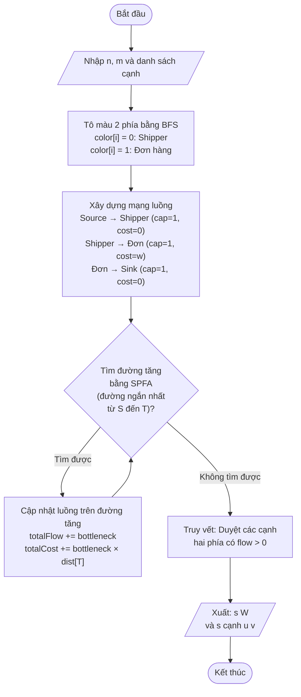
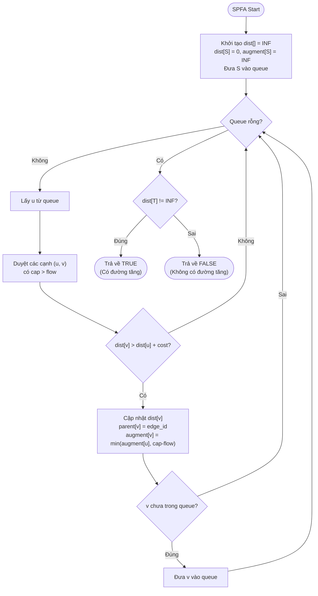
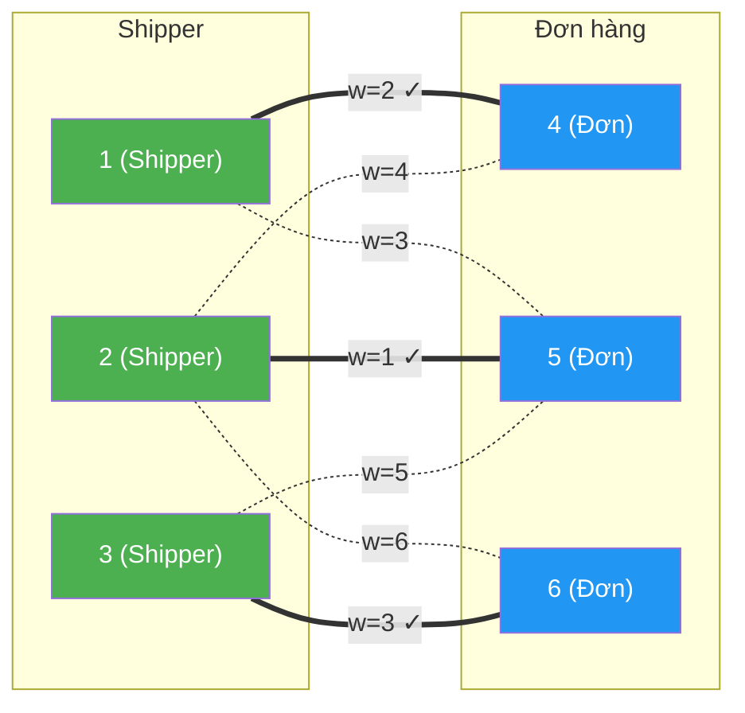

# BÀI TẬP 5: Phân công Shipper cho Đơn hàng theo Khoảng cách

## 1. Mô tả Bài toán

Một cửa hàng có nhiều **shipper** và nhiều **đơn hàng** cần lấy tại các điểm khác nhau trong thành phố.

**Ràng buộc:**
- Mỗi shipper nhận **tối đa 1 đơn**, mỗi đơn chỉ giao bởi **tối đa 1 shipper**
- Cạnh tồn tại giữa shipper `u` và đơn `v` nếu khoảng cách ≤ 6 km
- Trọng số cạnh = khoảng cách (km) hoặc thời gian di chuyển (phút)

**Mục tiêu (2 ưu tiên):**
1. **Ghép nhiều cặp nhất** có thể (tối đa số đơn/shipper khả dụng)
2. Trong tất cả các bộ ghép cực đại, **chọn bộ ghép có tổng quãng đường nhỏ nhất**

→ Đây là bài toán **Ghép cực đại trọng số nhỏ nhất trên đồ thị hai phần** (Minimum Cost Maximum Matching in Bipartite Graph).

**Định dạng vào/ra:**

| | Mô tả |
|---|---|
| **Input** | Dòng 1: `n m` (số đỉnh, số cạnh). m dòng tiếp: `u v w` |
| **Output** | Dòng 1: `s W` (số cặp ghép cực đại, tổng trọng số nhỏ nhất). s dòng tiếp: `u v` |

---

## 2. Phân tích và Giải thuật

### 2.1. Nhận diện bài toán

Bài toán có cấu trúc **đồ thị hai phần (Bipartite Graph)**:
- **Tập trái (L):** các shipper
- **Tập phải (R):** các đơn hàng  
- **Cạnh:** shipper u có thể giao đơn v (khoảng cách ≤ 6 km)

Yêu cầu tìm:
1. **Maximum Matching** (ghép cực đại)
2. Trong các maximum matching, tìm **minimum weight** (tổng trọng số nhỏ nhất)

→ Bài toán **Min-Cost Max-Flow (MCMF)**.

### 2.2. Giải thuật: Min-Cost Max-Flow (Luồng cực đại chi phí cực tiểu)

#### Ý tưởng mô hình hóa

Chuyển bài toán ghép cặp thành bài toán **mạng luồng** (flow network):

```
           cap=1, cost=0          cap=1, cost=w         cap=1, cost=0
Source ──────────────► Shipper_u ──────────────► Order_v ──────────────► Sink
```

**Xây dựng mạng luồng:**
1. Thêm đỉnh **Source (S)** và **Sink (T)**
2. **S → mỗi Shipper:** cạnh dung lượng = 1, chi phí = 0
3. **Shipper u → Đơn v:** cạnh dung lượng = 1, chi phí = w (trọng số)
4. **Mỗi Đơn → T:** cạnh dung lượng = 1, chi phí = 0

#### Thuật toán SPFA tìm đường tăng

Sử dụng **SPFA (Shortest Path Faster Algorithm)** để tìm đường đi ngắn nhất (chi phí nhỏ nhất) từ S đến T trong mạng thặng dư. Lặp cho đến khi không còn đường tăng.

**Các bước chính:**

```
1. Tô màu đồ thị 2 phía (BFS) → xác định tập Shipper và tập Đơn hàng
2. Xây dựng mạng luồng (Source, Sink, các cạnh)
3. Lặp:
   a. Dùng SPFA tìm đường tăng chi phí nhỏ nhất từ S đến T
   b. Nếu không tìm được → dừng
   c. Cập nhật luồng trên đường tăng
4. Truy vết các cạnh có luồng > 0 → bộ ghép kết quả
```

### 2.3. Độ phức tạp

| Thành phần | Độ phức tạp |
|---|---|
| Tô màu 2 phía (BFS) | O(V + E) |
| SPFA mỗi lần | O(V × E) |
| Số lần lặp MCMF | O(f) = O(min(\|L\|, \|R\|)) |
| **Tổng cộng** | **O(V × E × f)** |

Với V = n+2, E = n+m, f ≤ n/2. Phù hợp cho đồ thị cỡ vài nghìn đỉnh.

---

## 3. Lưu đồ Thuật toán



### Lưu đồ chi tiết SPFA (tìm đường tăng chi phí nhỏ nhất)



---

## 4. So sánh các Giải pháp

### 4.1. Bảng so sánh thuật toán

| Tiêu chí | Min-Cost Max-Flow (MCMF) | Hungarian Algorithm | Hopcroft-Karp + Tối ưu trọng số |
|---|---|---|---|
| **Ý tưởng** | Mô hình mạng luồng, tìm đường tăng chi phí nhỏ nhất | Ma trận chi phí, giảm hàng/cột | Ghép cực đại trước, tối ưu trọng số sau |
| **Độ phức tạp** | O(V × E × f) | O(n³) | O(E√V) + O(n³) |
| **Ưu điểm** | Giải trực tiếp cả 2 mục tiêu cùng lúc; tổng quát | Tối ưu cho bài toán gán vuông | Hopcroft-Karp rất nhanh cho ghép cực đại |
| **Nhược điểm** | Chậm hơn với đồ thị dày đặc | Chỉ cho ghép hoàn hảo, cần chỉnh sửa | Phức tạp khi kết hợp 2 bước |
| **Phù hợp** | ✅ Tốt nhất cho bài này | Khi n shipper = n đơn | Khi chỉ cần ghép cực đại |

### 4.2. So sánh ngôn ngữ lập trình

| Tiêu chí | C++ | Python | Java |
|---|---|---|---|
| **Tốc độ** | ⭐⭐⭐⭐⭐ Nhanh nhất | ⭐⭐ Chậm (100-200x) | ⭐⭐⭐⭐ Nhanh |
| **Cài đặt** | Phức tạp trung bình | Đơn giản, có thư viện `networkx` | Phức tạp |
| **Thư viện** | STL đủ dùng | `networkx.min_cost_flow()` | Cần tự cài |
| **Phù hợp** | ✅ Thi đấu, hiệu suất cao | Prototype nhanh | Enterprise |

### 4.3. Phân tích ưu nhược điểm giải pháp đã chọn

**Giải pháp:** Min-Cost Max-Flow + SPFA (C++)

**Ưu điểm:**
- ✅ Giải quyết đồng thời cả 2 mục tiêu (max matching + min cost)
- ✅ Đúng đắn: đảm bảo tìm được nghiệm tối ưu toàn cục
- ✅ Tổng quát: hoạt động với mọi đồ thị hai phần (không cần ghép hoàn hảo)
- ✅ Hiệu quả: tốc độ đủ nhanh cho bài toán cỡ vừa

**Nhược điểm:**
- ❌ Cài đặt phức tạp hơn Hopcroft-Karp đơn thuần
- ❌ Với đồ thị cực lớn (> 10⁵ đỉnh), có thể cần thuật toán chuyên biệt hơn

---

## 5. Code nguồn C++

Xem file: [BT5.cpp](file:///c:/hehe/Chuyende2/BT5/BT5.cpp)

### Cấu trúc code:

```
BT5.cpp
├── struct Edge            // Cấu trúc cạnh trong mạng luồng
├── struct MinCostMaxFlow  // Lớp MCMF
│   ├── addEdge()          // Thêm cạnh (thuận + nghịch)
│   ├── spfa()             // Tìm đường tăng chi phí nhỏ nhất
│   └── solve()            // Giải MCMF
└── main()
    ├── Đọc input
    ├── Tô màu 2 phía (BFS)
    ├── Xây dựng mạng luồng
    ├── Giải MCMF
    └── Xuất kết quả
```

---

## 6. Kết quả chạy mẫu

### Input ([input.txt](file:///c:/hehe/Chuyende2/BT5/input.txt)):
```
6 7
1 4 2
1 5 3
2 4 4
2 5 1
2 6 6
3 5 5
3 6 3
```

**Giải thích input:**
- 6 đỉnh, 7 cạnh
- Shipper: {1, 2, 3}, Đơn hàng: {4, 5, 6}
- Ví dụ: Shipper 1 có thể giao Đơn 4 (khoảng cách 2 km)

### Output:
```
3 6
1 4
2 5
3 6
```

**Giải thích output:**
- **3 cặp ghép** (cực đại — tất cả shipper đều được phân công)
- **Tổng trọng số = 6** (nhỏ nhất trong tất cả các bộ ghép cực đại)

### Kiểm chứng thủ công:

| Bộ ghép | Các cặp | Tổng trọng số | Nhận xét |
|---|---|---|---|
| **Bộ 1** ✅ | 1→4 (2), 2→5 (1), 3→6 (3) | **6** | **Tối ưu** |
| Bộ 2 | 1→4 (2), 2→6 (6), 3→5 (5) | 13 | Không tối ưu |
| Bộ 3 | 1→5 (3), 2→4 (4), 3→6 (3) | 10 | Không tối ưu |

→ Kết quả chương trình **đúng**: chọn được bộ ghép cực đại (3 cặp) có tổng trọng số nhỏ nhất (6).

---

## 7. Minh họa đồ thị



> **Nét đậm (===):** Cạnh được chọn trong bộ ghép tối ưu  
> **Nét đứt (-.-):** Cạnh không được chọn

---

## 8. Kết luận

Bài toán **Phân công Shipper cho Đơn hàng** là một ứng dụng thực tế của bài toán **Ghép cực đại trọng số nhỏ nhất trên đồ thị hai phần**. Giải thuật **Min-Cost Max-Flow** sử dụng **SPFA** là lựa chọn phù hợp nhất vì:

1. Giải quyết **đồng thời** cả hai mục tiêu (max matching + min cost)
2. Đảm bảo **tính đúng đắn** (nghiệm tối ưu toàn cục)
3. **Hiệu quả** với độ phức tạp O(V × E × f), phù hợp cho đồ thị cỡ vừa
4. **Tổng quát** — không yêu cầu ghép hoàn hảo
