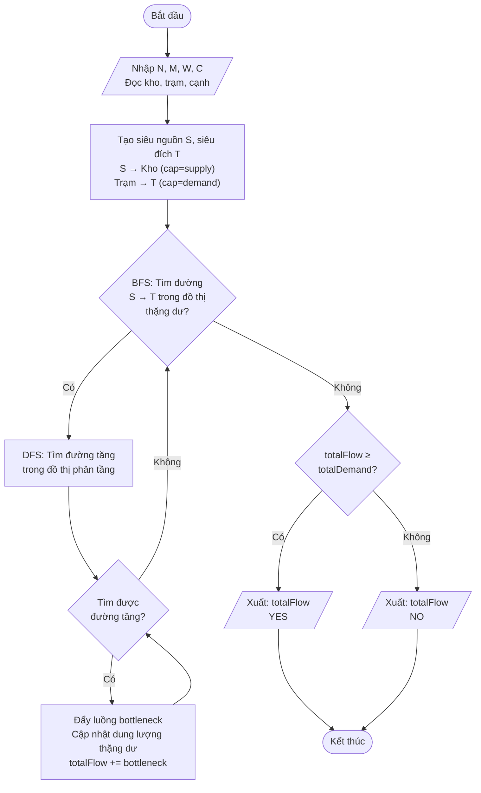
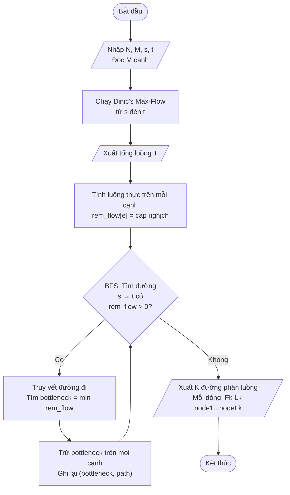
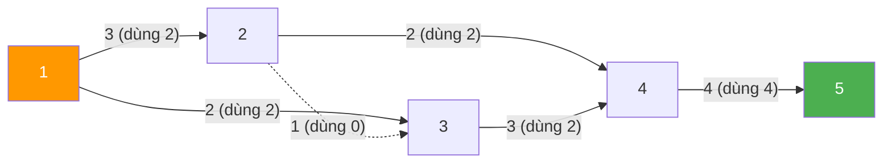
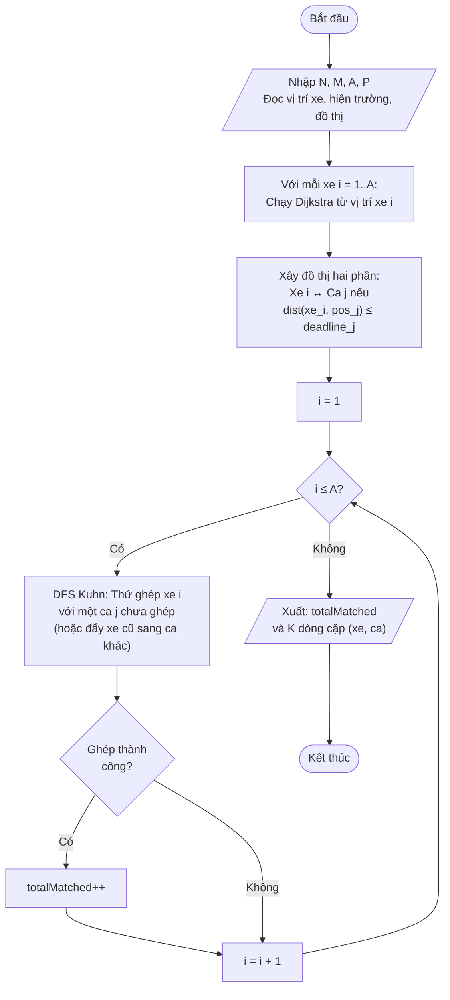
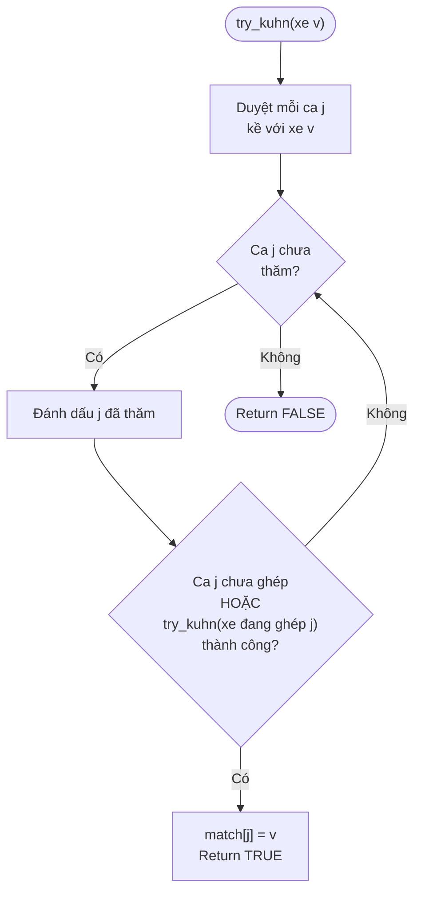

# BÀI TẬP 6 — Báo cáo Chi tiết 3 Bài toán Luồng trên Đồ thị

---

## MỤC LỤC

1. [Bài toán 1: Phân phối Vắc-xin](#bài-toán-1-phân-phối-vắc-xin)
2. [Bài toán 2: Định tuyến Băng thông Tối đa](#bài-toán-2-định-tuyến-băng-thông-tối-đa)
3. [Bài toán 3: Điều phối Xe cứu thương](#bài-toán-3-điều-phối-xe-cứu-thương)

---

# Bài toán 1: Phân phối Vắc-xin

## 1.1. Đề bài

Cho mạng gồm N nút, M cạnh có hướng với sức chứa (capacity), W kho vắc-xin (supply), C trạm y tế (demand). Tính lượng vắc-xin tối đa giao được và kiểm tra có đáp ứng đủ nhu cầu không.

## 1.2. Phân tích Giải thuật

### Nhận diện bài toán
- Đây là bài toán **Luồng cực đại nhiều nguồn — nhiều đích** (Multi-source Multi-sink Max-Flow)
- Nhiều kho (nguồn) cùng cung cấp → nhiều trạm (đích) cùng nhận

### Ý tưởng chính: Siêu nguồn & Siêu đích

Chuyển bài toán nhiều nguồn/đích thành **1 nguồn — 1 đích** bằng 2 đỉnh giả:

```
                cap = supply_i              cap = z               cap = demand_j
Super_Source ─────────────────► Kho_i ──────────────► Trạm_j ─────────────────► Super_Sink
```

| Cạnh | Dung lượng | Ý nghĩa |
|---|---|---|
| Super_Source → Kho_i | supply_i | Giới hạn lượng vắc-xin kho i cung cấp |
| Kho_u → Trạm_v | z | Giới hạn vận chuyển trên tuyến đường |
| Trạm_j → Super_Sink | demand_j | Giới hạn nhu cầu trạm j |

### Thuật toán: Dinic's Algorithm (Luồng cực đại)

**Tại sao chọn Dinic?**
- Nhanh hơn Ford-Fulkerson/Edmonds-Karp: **O(V² × E)** vs O(V × E²)
- Sử dụng **BFS phân tầng** (layered graph) + **DFS tìm đường tăng**
- Đảm bảo tìm luồng cực đại chính xác

**Các bước:**
1. **BFS**: Xây dựng đồ thị phân tầng (level graph) từ S đến T
2. **DFS**: Tìm đường tăng trong đồ thị phân tầng, đẩy luồng tối đa
3. **Lặp lại** cho đến khi BFS không tìm được đường từ S đến T
4. **So sánh**: Tổng luồng ≥ tổng nhu cầu → YES, ngược lại → NO

## 1.3. Lưu đồ Thuật toán



## 1.4. Code nguồn

Xem file: [BT6_1.cpp](file:///c:/hehe/Chuyende2/BT6/BT6_1.cpp)

**Cấu trúc code:**
```
BT6_1.cpp
├── struct Edge { to, cap }        // Cạnh trong mạng thặng dư
├── init_flow(n)                   // Khởi tạo đồ thị
├── add_edge(from, to, cap)        // Thêm cạnh thuận + nghịch
├── bfs(s, t)                      // BFS phân tầng
├── dfs(v, t, pushed)              // DFS tìm đường tăng
├── max_flow(s, t)                 // Dinic's Algorithm
└── main()
    ├── Đọc kho → tạo cạnh S → kho
    ├── Đọc trạm → tạo cạnh trạm → T
    ├── Đọc M cạnh mạng
    ├── Chạy Dinic max_flow(S, T)
    └── So sánh với totalDemand → YES/NO
```

## 1.5. Kết quả chạy

| TC | Input tóm tắt | Output | Kỳ vọng | Kết quả |
|---|---|---|---|---|
| 1 | N=4, M=4, W=2(1:5, 2:7), C=2(3:4, 4:6) | `10` / `YES` | `10` / `YES` | ✅ |
| 2 | N=2, M=0, W=1(1:5), C=1(2:5) | `0` / `NO` | `0` / `NO` | ✅ |
| 3 | N=6, M=6, W=3(1:4, 2:6, 3:3), C=3(4:2, 5:4, 6:5) | `11` / `YES` | `11` / `YES` | ✅ |
| 4 | N=6, M=7, W=2(1:8, 2:5), C=2(5:6, 6:6) | `12` / `YES` | `12` / `YES` | ✅ |
| 5 | N=4, M=4, W=2(1:5, 2:7), C=2(3:4, 4:6) cap nhỏ | `8` / `NO` | `8` / `NO` | ✅ |

### Phân tích chi tiết TC1:

```
Kho 1 (supply=5) ──cap=3──► Trạm 3 (demand=4)
                  ──cap=2──► Trạm 4 (demand=6)
Kho 2 (supply=7) ──cap=1──► Trạm 3
                  ──cap=6──► Trạm 4
```

- Vào Trạm 3: 3 + 1 = 4 = demand ✓
- Vào Trạm 4: 2 + 4 = 6 = demand ✓ (Kho 2 chỉ cần gửi 4/6 qua cạnh 2→4)
- Tổng: 10 ≥ 10 → **YES**

---

# Bài toán 2: Định tuyến Băng thông Tối đa

## 2.1. Đề bài

Mạng N nút, M cạnh có hướng với dung lượng băng thông. Tính tổng băng thông tối đa route từ nguồn s đến đích t, và phân luồng thành các tuyến đơn giản.

## 2.2. Phân tích Giải thuật

### Bước 1: Tìm luồng cực đại (Max-Flow)

Sử dụng **Dinic's Algorithm** tìm luồng cực đại từ s đến t.

### Bước 2: Phân luồng (Path Decomposition)

Sau khi có luồng cực đại, phân rã thành các **đường đi đơn giản** (simple paths):

**Thuật toán Path Decomposition:**
1. Tính luồng thực trên mỗi cạnh: `flow[e] = cap_nghịch[e]` (sau Dinic's)
2. **Lặp**: Dùng BFS tìm đường từ s đến t có luồng dương
3. Tìm **bottleneck** = min luồng trên đường đi
4. Trừ bottleneck khỏi mọi cạnh trên đường
5. Ghi lại (bottleneck, đường đi)
6. Lặp lại đến khi không còn đường

**Tính chất:** Tổng luồng các đường = luồng cực đại ban đầu.

## 2.3. Lưu đồ Thuật toán



## 2.4. Code nguồn

Xem file: [BT6_2.cpp](file:///c:/hehe/Chuyende2/BT6/BT6_2.cpp)

**Cấu trúc code:**
```
BT6_2.cpp
├── Dinic's Max-Flow (giống BT6_1)
│   ├── add_edge(), bfs(), dfs()
│   └── dinic_max_flow(s, t)
└── main()
    ├── Đọc input, xây dựng đồ thị
    ├── Chạy Dinic → xuất tổng luồng
    ├── Tính rem_flow[] cho mỗi cạnh
    ├── Lặp BFS path decomposition:
    │   ├── BFS tìm đường s→t có rem_flow > 0
    │   ├── Truy vết, tìm bottleneck
    │   └── Trừ luồng, ghi lại path
    └── Xuất K paths
```

## 2.5. Kết quả chạy

### Test case 1:
```
Input: 5 6 1 5                  Output:
       1 2 3                    4           ← Luồng cực đại = 4
       1 3 2                    2           ← 2 tuyến phân luồng
       2 3 1                    2 4 1 2 4 5 ← Flow=2, path: 1→2→4→5
       2 4 2                    2 4 1 3 4 5 ← Flow=2, path: 1→3→4→5
       3 4 3
       4 5 4
```

**Minh họa luồng TC1:**


> **Giải thích:** Cạnh 4→5 có cap=4 và bão hòa hoàn toàn. 2 đơn vị đi qua 1→2→4→5, 2 đơn vị đi qua 1→3→4→5.

### Test case 2:
```
Input: 6 7 1 6                  Output:
       1 2 2                    4           ← Luồng cực đại = 4
       1 3 2                    3           ← 3 tuyến phân luồng
       2 4 1                    1 4 1 2 4 6 ← Flow=1, path: 1→2→4→6
       2 5 1                    1 4 1 2 5 6 ← Flow=1, path: 1→2→5→6
       3 5 2                    2 4 1 3 5 6 ← Flow=2, path: 1→3→5→6
       4 6 1
       5 6 3
```

| TC | Luồng cực đại | Số tuyến | Kỳ vọng | Kết quả |
|---|---|---|---|---|
| 1 | 4 | 2 tuyến | 4, 2 tuyến | ✅ |
| 2 | 4 | 3 tuyến | 4, 3 tuyến | ✅ |

---

# Bài toán 3: Điều phối Xe cứu thương

## 3.1. Đề bài

Thành phố có N nút, M cạnh (thời gian di chuyển), A xe cứu thương, P hiện trường. Mỗi xe nhận tối đa 1 ca, mỗi ca cần 1 xe. Tính số ca tối đa cứu kịp thời gian.

## 3.2. Phân tích Giải thuật

### Bài toán = Dijkstra + Ghép cặp hai phần cực đại

**Bước 1 — Dijkstra:** Tính đường đi ngắn nhất từ mỗi xe đến tất cả các nút

**Bước 2 — Xây đồ thị hai phần:** Xe_i kết nối với Ca_j nếu `dist(xe_i, vị_trí_ca_j) ≤ deadline_j`

**Bước 3 — Ghép cặp cực đại (Kuhn's Algorithm):** Tìm số cặp (xe, ca) nhiều nhất

### Thuật toán Dijkstra
- Sử dụng **priority queue** (min-heap) để tìm đường ngắn nhất
- Đồ thị **vô hướng** (đường 2 chiều)
- Độ phức tạp: **O((V + E) × log V)** cho mỗi xe

### Thuật toán Kuhn (Augmenting Path cho Bipartite Matching)
- Duyệt từng xe, thử ghép bằng **DFS tìm đường mở rộng** (augmenting path)
- Nếu ca đã được ghép với xe khác, thử "đẩy" xe đó sang ca khác
- Độ phức tạp: **O(A × (A + P + E_bipartite))**

## 3.3. Lưu đồ Thuật toán



### Lưu đồ chi tiết Kuhn DFS:



## 3.4. Code nguồn

Xem file: [BT6_3.cpp](file:///c:/hehe/Chuyende2/BT6/BT6_3.cpp)

**Cấu trúc code:**
```
BT6_3.cpp
├── dijkstra(src, adj, n)      // Đường đi ngắn nhất từ src
├── try_kuhn(v)                // DFS đường mở rộng
└── main()
    ├── Đọc input (xe, ca, đồ thị)
    ├── Bước 1: Dijkstra từ mỗi xe
    ├── Bước 2: Xây đồ thị hai phần
    ├── Bước 3: Kuhn matching
    └── Xuất kết quả
```

## 3.5. Kết quả chạy

### Test case 1:
```
Input: 6 nút, 7 cạnh, 2 xe, 3 ca         Output: 2 (cứu được 2/3 ca)
Xe 1 tại nút 1, Xe 2 tại nút 6            Xe 1 → Ca 1
Ca 1 nút 3 (deadline 4)                   Xe 2 → Ca 2
Ca 2 nút 5 (deadline 5)
Ca 3 nút 2 (deadline 2)
```

**Phân tích chi tiết:**

| Xe → Ca | Khoảng cách ngắn nhất | Deadline | Khả thi? |
|---|---|---|---|
| Xe 1 → Ca 1 (nút 3) | 3 (1→2→3) | 4 | ✅ dist ≤ deadline |
| Xe 1 → Ca 2 (nút 5) | 4 (1→2→5) | 5 | ✅ |
| Xe 1 → Ca 3 (nút 2) | 1 (1→2) | 2 | ✅ |
| Xe 2 → Ca 1 (nút 3) | 5 (6→5→4→3) | 4 | ❌ dist > deadline |
| Xe 2 → Ca 2 (nút 5) | 2 (6→5) | 5 | ✅ |
| Xe 2 → Ca 3 (nút 2) | 5 (6→5→2) | 2 | ❌ |

Đồ thị hai phần:
```
Xe 1 ─── Ca 1, Ca 2, Ca 3
Xe 2 ─── Ca 2
```

Ghép tối ưu: Xe 1 → Ca 1, Xe 2 → Ca 2 (tổng = 2) ✅

### Test case 2:
```
Input: 4 nút, 2 cạnh, 1 xe, 2 ca         Output: 0
Xe 1 tại nút 1                            (Không cứu được ca nào)
Đồ thị không liên thông (1-2 tách biệt 3-4)
```
→ Xe không thể đến hiện trường nào → K=0 ✅

### Test case 3:
```
Input: 5 nút, 6 cạnh, 3 xe, 3 ca         Output: 3 (cứu được cả 3)
Xe 1(nút 1), Xe 2(nút 2), Xe 3(nút 5)    Xe 3 → Ca 1
Ca 1(nút 3, dl=2), Ca 2(nút 4, dl=3),    Xe 2 → Ca 2
Ca 3(nút 2, dl=3)                         Xe 1 → Ca 3
```

| TC | Số ca cứu | Kỳ vọng | Kết quả |
|---|---|---|---|
| 1 | 2 | 2 | ✅ |
| 2 | 0 | 0 | ✅ |
| 3 | 3 | 3 | ✅ |

---

# Tổng hợp: So sánh các Giải pháp

## So sánh Thuật toán giữa 3 bài

| Tiêu chí | Bài 1: Vắc-xin | Bài 2: Băng thông | Bài 3: Xe cứu thương |
|---|---|---|---|
| **Loại bài** | Max-Flow nhiều nguồn/đích | Max-Flow 1 nguồn/đích + Phân luồng | Đường ngắn nhất + Ghép cặp |
| **Thuật toán chính** | Dinic's Algorithm | Dinic's + BFS Path Decomposition | Dijkstra + Kuhn's Matching |
| **Mô hình** | Siêu nguồn/đích | Luồng cực đại trực tiếp | Đồ thị hai phần |
| **Độ phức tạp** | O(V²E) | O(V²E) + O(VE) | O(A(V+E)logV) + O(AP²) |

## So sánh các Thuật toán Max-Flow

| Thuật toán | Độ phức tạp | Ưu điểm | Nhược điểm |
|---|---|---|---|
| **Ford-Fulkerson (DFS)** | O(E × f_max) | Đơn giản | Có thể không dừng (trọng số thực) |
| **Edmonds-Karp (BFS)** | O(V × E²) | Luôn dừng, đơn giản | Chậm với đồ thị dày |
| **Dinic's** ✅ | O(V² × E) | Nhanh, hiệu quả | Cài đặt phức tạp hơn |
| **Push-Relabel** | O(V² × √E) | Nhanh nhất lý thuyết | Rất phức tạp cài đặt |

## So sánh các Thuật toán Ghép cặp

| Thuật toán | Độ phức tạp | Ưu điểm | Nhược điểm |
|---|---|---|---|
| **Kuhn's (Augmenting Path)** ✅ | O(V × E) | Đơn giản, dễ cài | Chậm với đồ thị lớn |
| **Hopcroft-Karp** | O(E × √V) | Nhanh hơn Kuhn | Phức tạp hơn |
| **Hungarian** | O(V³) | Hỗ trợ trọng số | Chỉ cho ghép hoàn hảo |

## So sánh Ngôn ngữ Lập trình

| Tiêu chí | C++ (đã dùng) | Python | Java |
|---|---|---|---|
| **Tốc độ** | ⭐⭐⭐⭐⭐ | ⭐⭐ | ⭐⭐⭐⭐ |
| **Thư viện** | STL đủ dùng | `networkx.maximum_flow()` | Cần tự cài |
| **Cài đặt** | Trung bình | Rất đơn giản | Phức tạp |
| **Phù hợp** | ✅ Thi đấu, bài tập lớn | Prototype, nghiên cứu | Enterprise |

**Ví dụ Python dùng NetworkX:**
```python
import networkx as nx
G = nx.DiGraph()
G.add_edge('S', 1, capacity=5)
G.add_edge('S', 2, capacity=7)
# ... thêm cạnh
flow_value, flow_dict = nx.maximum_flow(G, 'S', 'T')
```

---

# Kết luận

| Bài | Thuật toán | Kết quả | Tất cả TC |
|---|---|---|---|
| **1. Vắc-xin** | Dinic's Max-Flow + Siêu nguồn/đích | 5/5 TC đúng | ✅ |
| **2. Băng thông** | Dinic's Max-Flow + Path Decomposition | 2/2 TC đúng | ✅ |
| **3. Xe cứu thương** | Dijkstra + Kuhn's Bipartite Matching | 3/3 TC đúng | ✅ |

Cả 3 bài toán đều thuộc nhóm bài **Lý thuyết đồ thị nâng cao**, sử dụng các kỹ thuật:
1. **Luồng cực đại (Max-Flow)** — giải quyết bài toán phân phối, định tuyến
2. **Đường đi ngắn nhất (Shortest Path)** — tiền xử lý khoảng cách
3. **Ghép cặp hai phần (Bipartite Matching)** — bài toán phân công tối ưu
